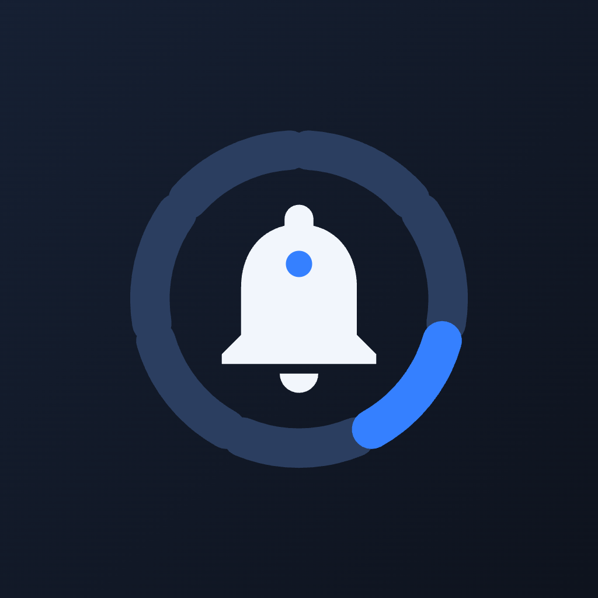
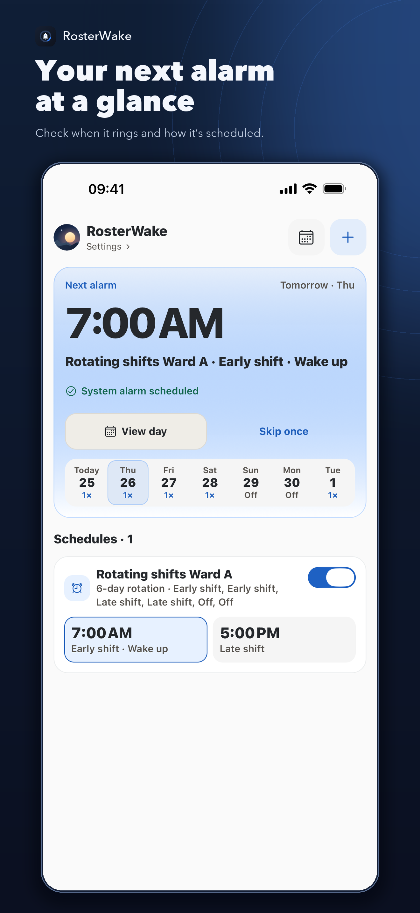
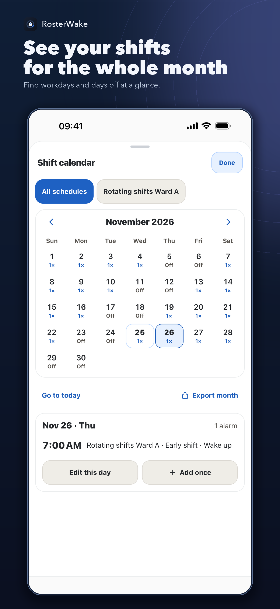
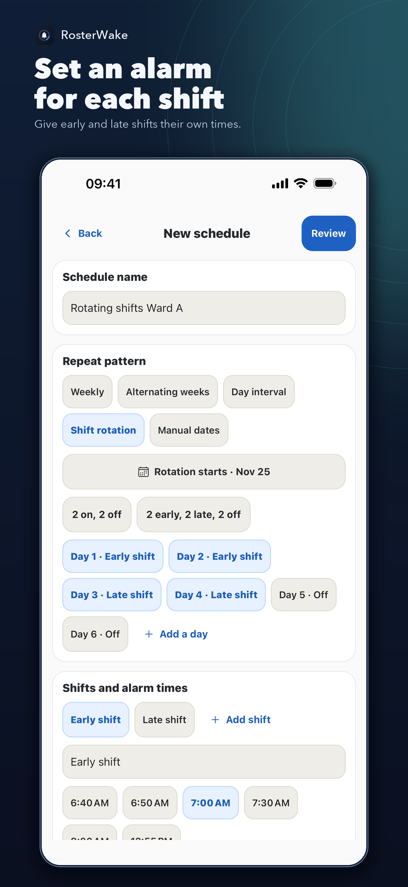

<h1 align="center">
  
  RosterWake
</h1>

<p align="center"><strong>A shift alarm for work schedules that change.</strong></p>
<p align="center">English · <a href="README.zh-CN.md">简体中文</a></p>

<p align="center">
  <a href="docs/store-launch/en-US/app-store/01-next-alarm.png"></a>
  <a href="docs/store-launch/en-US/app-store/02-calendar.png"></a>
  <a href="docs/store-launch/en-US/app-store/03-rotation.png"></a>
</p>

<p align="center"><a href="docs/screens/promo.gif">Watch the demo (GIF, v0.3.0, Simplified Chinese)</a></p>

Set a repeating shift rotation or pick dates on a calendar. RosterWake schedules your alarms from that plan and shows you which one is due next. Your schedules stay on your device.

## Download

| Platform | Where to find it |
| --- | --- |
| Android APK | [Latest stable APK](https://github.com/TNT-Likely/zhouerfuqi/releases/latest). Most Android phones use `arm64-v8a`. |
| Android on Google Play | [Closed test enrollment](https://github.com/TNT-Likely/zhouerfuqi/issues/1). |
| iOS | [Join the public TestFlight beta](https://testflight.apple.com/join/9vNcHgha). |

The 0.4.0 release includes English and Simplified Chinese. The screenshots above show 0.4.0.

## How it works

1. Choose weekdays, alternating Saturdays, a rotation such as 2 on and 2 off, or individual dates. Give each shift its own alarms.
2. Check the next alarm on the home screen or widget. Use the monthly calendar to skip an alarm or change a single day.
3. Open **Settings → Test alarm** to check the lock-screen behavior on your device.

On iOS 26 and later, RosterWake uses AlarmKit when alarm permission is granted. Earlier versions use local notifications. Android exact alarms and full-screen ringing depend on the device and its permission settings.

You can export your schedule as a calendar file, or keep a JSON backup to restore later.

## Development

The mobile app uses Expo and React Native. The scheduling engine lives in `packages/core`. Use Node.js 24 and pnpm 11.

```bash
pnpm install --frozen-lockfile
pnpm test
pnpm --dir apps/mobile start
```

[Report an issue](https://github.com/TNT-Likely/zhouerfuqi/issues) · [Privacy policy](docs/privacy.md) · [Support the developer](https://github.com/TNT-Likely/BeeCount#-捐赠支持) · [MIT license](LICENSE)
