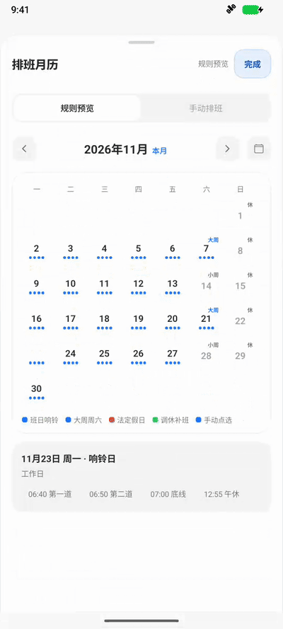
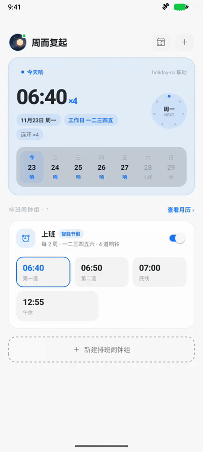
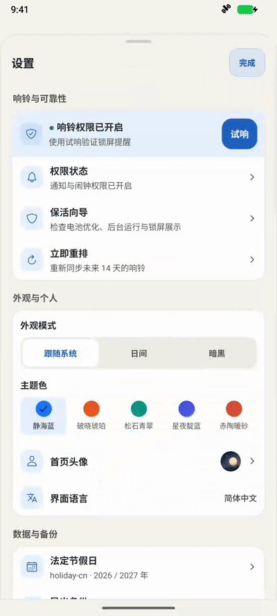

<h1 align="center">
  
  周而复起
</h1>

<p align="center"><strong>闹钟周而复起，班表从不掉链子。</strong></p>

<p align="center">
  <a href="docs/screens/calendar.png"></a>
  <a href="docs/screens/promo.gif"></a>
  <a href="docs/screens/settings-theme.png"></a>
</p>

<p align="center">
  <a href="#下载">下载</a> · <a href="#从班表到响铃">使用方式</a> · <a href="#支持开发">支持开发</a>
</p>

为大小周、轮班和自定义月历排班设计的开源闹钟。按班表安排响铃，数据保存在设备上，支持备份和恢复。

## 下载

| 渠道 | 入口 |
| --- | --- |
| Android APK | [下载最新正式版](https://github.com/TNT-Likely/zhouerfuqi/releases/latest)。大多数安卓手机选择 `arm64-v8a`。 |
| Android Google Play | [查看封闭测试招募和加入方式](https://github.com/TNT-Likely/zhouerfuqi/issues/1)。 |
| iOS | [安装 TestFlight](https://apps.apple.com/app/testflight/id899247664)，再[加入周而复起测试](https://testflight.apple.com/join/9vNcHgha)。 |

通过 GitHub APK 安装的用户，可在 **设置 → 检查更新** 中升级。

## 从班表到响铃

1. 在首页新建班组，选择排班规则。同一个班组可以设多个响铃时间，并一键开关整组。
2. 在首页查看未来七天的安排，也可以打开月历查看整月班表。
3. 在 **设置 → 试响** 安排一次 30 秒试响，检查锁屏时的效果。

| 规则 | 用法 |
| --- | --- |
| 每周几 | 每周固定在选中的星期几响铃，例如周一到周五。 |
| 每 N 周 | 用一个锚点设置大小周等轮班周期。 |
| 每 N 天 | 按固定天数间隔响铃，例如每三天一次。 |
| 自定义月历 | 直接选中需要响铃的日期，适合每月变化的班表。 |

开启节假日联动后，周期班表会跳过放假日期，并在调休补班日响铃。自定义月历以手动点选为准。节假日数据来自 [holiday-cn](https://github.com/NateScarlet/holiday-cn)。

## 响铃、外观与备份

- **Android** 支持精确闹钟和锁屏全屏界面。可以在设置里查看响铃权限，按保活向导完成手机上的配置。
- **iOS** 在 iOS 26 及以上使用 AlarmKit。较早的系统使用本地通知提醒。
- 在设置里可以切换日间或暗黑外观、调整主题色、更换头像，也可以导出和导入 JSON 备份。

## 开发

`packages/core` 是独立的 TypeScript 排班引擎，`apps/mobile` 是 Expo 和 React Native 应用。

使用 Node.js 24 和 pnpm 11。

```bash
pnpm install --frozen-lockfile
pnpm test
pnpm --dir apps/mobile start
```

原生构建和真机调试见 [开发交接](docs/HANDOFF.md)。规则模型与响铃调度见 [技术架构](docs/architecture.md)。界面交互见 [HTML 设计稿](design/index.html)。

GitHub Actions 提供三条发布流程。Release APK 发布签名 APK 和更新清单，Release Play 上传到 Google Play 封闭测试，Release iOS 上传到 TestFlight。

## 支持开发

如果周而复起帮你把班表和闹钟安排好了，欢迎通过同一作者的捐赠入口支持开发。[蜜蜂记账 BeeCount 捐赠页](https://github.com/TNT-Likely/BeeCount#-捐赠支持)

[问题反馈](https://github.com/TNT-Likely/zhouerfuqi/issues) · [隐私说明](docs/privacy.md) · [MIT 许可证](LICENSE)
