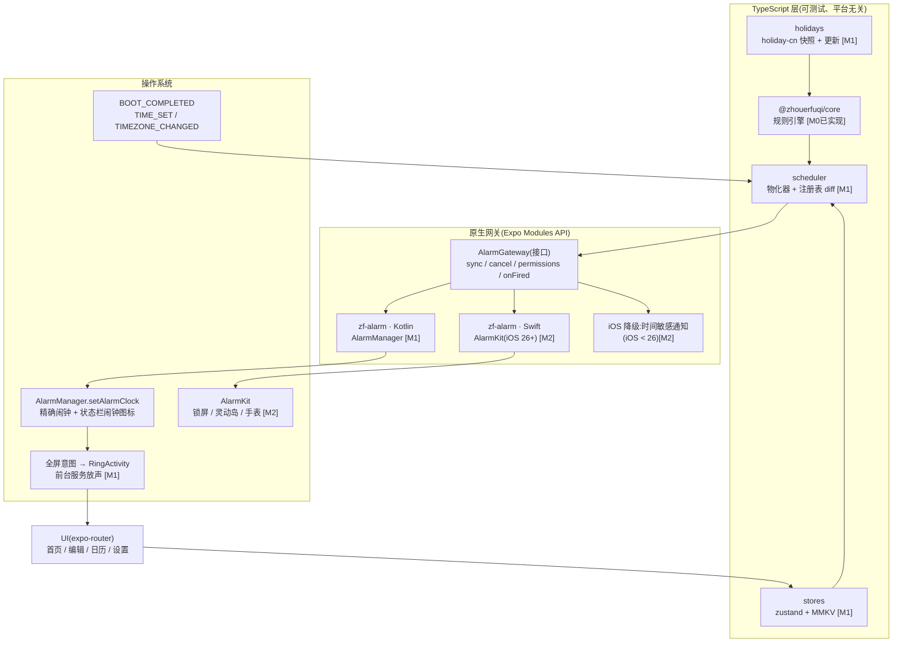
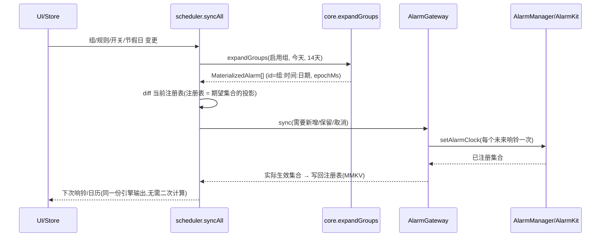

# 周而复起 · 技术架构

> v0.1 · 2026-11-14 · 配套:`packages/core`(已实现)、`design/index.html`(交互稿)
> 状态:本文档描述 **M0 已落地 + M1/M2 目标形态**,标注 `[M0已实现]` / `[M1]` / `[M2]` / `[M3]`

## 0. 四条架构原则

1. **本地优先**:无账号、无必然后端。规则、节假日快照、闹钟全部在设备内;联网只用于可选的节假日数据更新。
2. **规则引擎是唯一事实源**:响铃与否的判断只有一个实现(`@zhouerfuqi/core`),UI 预览、日历、原生闹钟物化全部消费同一份计算结果。设计稿内嵌的 JS 引擎与之一同语义对齐。
3. **物化具体响铃,不用原生周期重复**:每 N 周、节假日联动、补班兜底都无法用系统闹钟的「每周几」表达。引擎把规则展开为**未来 N 天的具体时间点**,原生层只负责"在指定 epoch 响一次"。跨端模型因此完全统一。
4. **厚 TS、薄原生**:业务逻辑(规则、diff、注册表)全在 TS;原生模块只做三件事——注册精确闹钟、触发时拉起响铃、汇报权限状态。

## 1. 总览



**依赖规则**:`core` 不 import 任何 RN/平台代码;`scheduler/holidays/stores` 可依赖 `core` 与原生网关的 **TS 接口**;原生实现只被网关调用。保证 core 永远可以被 node:test 直接测(现状如此)。

## 2. 目录结构(完整规划,✅=已存在)

```
zhouerfuqi/
├── .github/workflows/
│   ├── ci.yml                          # [M1] PR:core 测试 + typecheck
│   └── release-apk.yml                 # [M1] tag → gradle assembleRelease → APK artifact(华为侧载主渠道)
├── packages/
│   └── core/                           # ✅ 规则引擎(平台无关,唯一事实源)
│       ├── package.json                #    node:test 零依赖,typecheck:tsc
│       ├── src/
│       │   ├── index.ts                #    出口
│       │   ├── types.ts                #    AlarmGroup / RepeatRule / Occurrence / DayEvaluation
│       │   ├── dates.ts                #    纯 UTC 日期运算(无时区歧义)
│       │   ├── holidays.ts             #    HolidayCalendar(兼容 holiday-cn 格式)
│       │   └── schedule.ts             #    isRuleDay / evaluateDay / expand* / nextOccurrences
│       └── test/schedule.test.ts       #    13 用例
├── apps/mobile/                        # [M1] Expo RN(New Architecture,dev-client)
│   ├── app.config.ts                   #    图标/启动屏/MMKV config plugin
│   ├── app/                            # ── expo-router:路由即界面(对照设计稿)
│   │   ├── _layout.tsx                 #    主题 Provider(深色/日间,对应设计令牌)
│   │   ├── (tabs)/
│   │   │   ├── index.tsx               #    首页(设计稿 A:hero + 组列表)
│   │   │   ├── calendar.tsx            #    响铃日历(设计稿 C)
│   │   │   └── settings.tsx            #    设置:保活向导入口 / 铃声 / 备份 / 节假日更新
│   │   ├── group/[id].tsx              #    编辑组(设计稿 B;id="new" 为新建)
│   │   ├── ring.tsx                    #    响铃页(设计稿 D;原生全屏意图深链直达)
│   │   └── guide.tsx                   #    保活向导(设计稿 E;settings 可跳转)
│   ├── src/
│   │   ├── stores/                     # ── zustand + MMKV(开机重排需同步读)
│   │   │   ├── groups.ts               #    AlarmGroup[](持久化 groups.v1)
│   │   │   ├── settings.ts             #    horizon/铃声/贪睡(settings.v1)
│   │   │   └── guide.ts                #    向导进度(guide.v1)
│   │   ├── scheduler/                  # ── 物化层(架构 §4 的实现)
│   │   │   ├── materialize.ts          #    expandGroups → MaterializedAlarm[](id=组:时间:日期)
│   │   │   ├── registry.ts             #    注册表 diff(registry.v1,幂等)
│   │   │   └── sync.ts                 #    syncAll():规则变更/触发/开机/时区/每日03:30 统一入口
│   │   ├── gateway/                    # ── 原生网关(接口隔离,实现可替换)
│   │   │   ├── types.ts                #    AlarmGateway:sync/cancel/permissions/onFired/onDismiss
│   │   │   ├── notifyKit.ts            #    [M1] Android 实现(notify-kit,SET_ALARM_CLOCK)
│   │   │   ├── alarmKit.ts             #    [M2] iOS 26 实现(AlarmKit 封装)
│   │   │   └── index.ts                #    按平台装配;iOS<26 自动切降级实现
│   │   ├── services/
│   │   │   ├── holidays.ts             #    快照加载 / 可选在线更新 / 用户覆盖合并
│   │   │   └── backup.ts               #    整包导出/导入 JSON
│   │   └── components/                 #    GroupCard / TimePill / Chip / CalendarDay / Segmented
│   │       └── theme.ts                #    设计令牌(与 design/index.html CSS 变量一一对应)
│   ├── modules/zf-alarm/               # ── 自研 Expo Module(npx create-expo-module 脚手架)
│   │   ├── expo-module.config.json
│   │   ├── src/index.ts                #    TS API:sync(alarms)/cancel(ids)/requestPermissions()/onFired
│   │   └── android/src/main/…
│   │       ├── ZfAlarmModule.kt        #    setAlarmClock 注册/取消(requestCode=id 稳定哈希)
│   │       ├── ZfAlarmReceiver.kt      #    精确闹钟到点 → 全屏意图 + 闹钟通知
│   │       ├── BootReceiver.kt         #    BOOT_COMPLETED / TIME_SET / TIMEZONE_CHANGED → 触发重排
│   │       ├── RingActivity.kt         #    锁屏全屏响铃页(setShowWhenLocked/setTurnScreenOn)
│   │       └── RingService.kt          #    [M3] FGS 渐进音量引擎(M1 先用通知通道铃声)
│   ├── assets/
│   │   ├── holidays/2026.json          #    holiday-cn 年度快照(scripts 拉取,离线兜底)
│   │   ├── sounds/                     #    铃声
│   │   └── images/                     #    App 图标(由 design/logo.svg 生成)/ 启动屏
│   ├── android/ ios/                   #    prebuild 产物(dev-client)
│   └── maestro/                        #    [M1] E2E:建组→改锚点→日历断言
├── design/                             # ✅ 交互设计稿 + Logo
│   ├── index.html
│   ├── logo.svg
│   └── logo-mono.svg
├── docs/architecture.md                # ✅ 本文档
├── scripts/
│   └── fetch-holidays.mjs              # [M1] 拉 holiday-cn(注意 12 月跨年文件,官方 README 提示)
├── pnpm-workspace.yaml                 # ✅
├── package.json                        # ✅
├── .gitignore                          # ✅
├── LICENSE                             # ✅
└── README.md                           # ✅
```

**三条依赖红线**:

1. `packages/core` 不 import 任何 RN/平台代码——永远可以被 node:test 直接测;
2. `src/` 逻辑层只能依赖 `core` 与 `gateway/types.ts` 的**接口**,不直接摸原生模块——notify-kit → AlarmKit → 自研引擎的替换不动上层;
3. 路由层(`app/`)只做装配和跳转,业务规则一律下沉——响铃页被原生深链拉起时,`ring.tsx` 只是从 store 读"这次响的是哪条",不自己判断。

## 3. 技术选型## 3. 技术选型

| 决策 | 选择 | 理由 | 备选/回退 |
| --- | --- | --- | --- |
| 框架 | Expo(dev-client)+ RN New Architecture | 生态包兼容(nitro/turbo 模块);Expo Modules API 让 Swift/Kotlin 模块开发成本最低 | 裸 RN CLI(需要时随时可迁,core 不受影响) |
| 导航 | expo-router | 文件式路由,响铃页可由深链/全屏意图直接打开 | react-navigation 裸用 |
| 状态 | zustand + MMKV 持久化 | 开机重排需要**同步**读规则;MMKV 冷读最快 | AsyncStorage(M1 可先跑通再换) |
| Android 闹钟 | react-native-notify-kit(Notifee 新架构 fork),`alarmType: SET_ALARM_CLOCK` | `setAlarmClock` 是系统时钟同款 API:Doze/厂商省电豁免、带状态栏闹钟图标、OEM 白名单待遇最高;fork 已修 reboot 丢闹钟等坑 | 自研 Kotlin 引擎(M3 升级路径,接口不变) |
| iOS 26+ | AlarmKit(经 RN 封装:`react-native-ios-alarmkit`,不合适则自写 Expo module) | 与系统闹钟平起平坐:穿透静音/专注、锁屏/灵动岛/手表 | 自研 Swift Expo module(接口层已隔离,可无痛替换) |
| iOS < 26 | 时间敏感通知(明确标注"降级模式") | 平台能力上限如此,不撒谎 | 引导用户用快捷指令自动化(文档教程) |
| 节假日数据 | holiday-cn 年度 JSON 内置 + 可选 jsdelivr 更新 | MIT、CI 自动跟国务院公告 | 用户手动勾选节假日(MVP 兜底) |
| 存储 | MMKV(JSON 字符串值,含版本号) | 结构简单、可导出备份;量级只有几 KB | expo-sqlite(若未来要日历查询) |

## 4. 核心流水线

### 4.1 物化(任何规则变更后)



- **视野(Horizon)= 14 天**:日历预览与原生注册共用同一窗口。
- **每日刷新闹钟**:03:30 一枚 `setExactAndAllowWhileIdle` 自刷新闹钟,保证用户长期不打开 App 时视野不缩水。
- **幂等**:`id = ${groupId}:${timeId}:${date}`,diff 按 id,重复 sync 无副作用。

### 4.2 触发链(Android,M1)

```
setAlarmClock 到点
  → BroadcastReceiver(精确闹钟唤醒)
  → 通知:全屏意图 + 闹钟通道(铃声/振动)            ← 锁屏可见的第一跳
  → RingActivity(setShowWhenLocked/setTurnScreenOn)  ← 设计稿 D 屏
  → 用户动作:
     关闭 → scheduler.syncAll()(滚动补齐 14 天视野)
     贪睡 → 立即注册一枚一次性 +9min 闹钟
```

iOS(M2)由 AlarmKit 接管响铃与系统级 UI,App 只接收回调并做贪睡重排(自定义按钮走 LiveActivityIntent)。

## 5. 数据模型与持久化

沿用 `packages/core` 的类型,持久化为带版本号的 JSON 值(MMKV):

| Key | 内容 |
| --- | --- |
| `groups.v1` | `AlarmGroup[]`(id/name/enabled/times/rule/holidayMode) |
| `holidays.v1` | `{ years: HolidayData[] , fetchedAt, source }` |
| `registry.v1` | 物化注册表:`{ id → { epochMs, title } }`(网关 diff 的基准) |
| `settings.v1` | horizon 天数、铃声、默认贪睡 |
| `guide.v1` | 华为保活向导完成状态 |

备份/恢复:整包导出 JSON 文件(系统分享面板),导入做 schema 校验——开源产品用户最怕数据锁死。

## 6. Android 可靠性专项 [M1]

**权限矩阵**

| 权限 | 用途 | 授予方式 |
| --- | --- | --- |
| `USE_EXACT_ALARM` | 精确闹钟(目标 API 33+ 自动授予,闹钟类应用合规) | 清单声明即得 |
| `SCHEDULE_EXACT_ALARM` | API 31/32 设备的等价物 | Android 12 自动授予;运行时 `canScheduleExactAlarms()` 检查,缺失则引导 |
| `USE_FULL_SCREEN_INTENT` | 锁屏全屏响铃 | Android 14+ 默认拒绝,检测后深链设置页引导授予 |
| `POST_NOTIFICATIONS` | 触发通知(13+) | 运行时请求 |
| `RECEIVE_BOOT_COMPLETED` | 开机重排 | 清单;`syncAll()` 在 BOOT_COMPLETED 后执行 |
| 忽略电池优化 / 自启动 | 华为荣耀等 OEM 保活 | 引导向导(设计稿 E 屏)一次性完成 |

**重排触发点**:规则变更、闹钟触发、响铃被关闭、BOOT_COMPLETED、`TIME_SET`/`TIMEZONE_CHANGED`/`DATE_CHANGED`、App 回前台、每日 03:30 刷新闹钟。

**为什么必须 `setAlarmClock`**:它是系统时钟使用的同一 API——系统将其视为"用户可见的墙钟闹钟",享受 Doze 豁免、状态栏闹钟图标、以及绝大多数 OEM 省电白名单;这也是 notify-kit 文档对国产 ROM 的明确建议。

**华为 4.x 验收标准**(真机):锁屏过夜准确响铃 ×7 天、省电模式开启、最近任务清空后仍响、重启后 1 分钟内注册表恢复。

## 7. iOS 专项 [M2]

- **iOS 26+**:AlarmKit。授权(首次排期时系统弹窗,Info.plist 需 `NSAlarmKitUsageDescription`);固定日期一次性闹钟(与物化模型天然契合);响铃 UI 用系统默认(先跑通),自定义 Live Activity 界面放 M3。
- **iOS < 26**:时间敏感通知降级模式,设置页显著标注能力差异;文档提供"快捷指令自动化"替代方案教程(知休闹钟验证过的路线)。
- RN 封装选型:先试 `react-native-ios-alarmkit`;若 API 与物化模型不合,按 `AlarmGateway` 接口自写 Expo module(Swift + AlarmKit,工作量约一周)。**接口已隔离,替换不影响上层。**

## 8. 节假日数据管线 [M1]

```
holiday-cn (GitHub, MIT) → 构建期脚本拉取当年 JSON → 打包进 bundle(离线兜底)
                          → App 内可选检查更新(jsdelivr,schema 校验后替换)
                          → 用户手动覆盖(自定调休/公司特殊班日)存 holidays.user.v1,优先级最高
```

注意 holiday-cn 官方提示:12 月的日期可能被次年文件影响,更新脚本需同时检查两个年份文件。

## 9. 测试与 CI

| 层 | 手段 | 现状 |
| --- | --- | --- |
| core 规则引擎 | node:test,13 用例(零依赖,node ≥22.6 原生跑 TS) | ✅ |
| 设计稿引擎 | 设计稿内嵌 JS 引擎 + node 语法/冒烟校验 | ✅ |
| scheduler 物化 | mock Gateway 的 diff/幂等/视野滚动单测 | [M1] |
| E2E | Maestro:建组→改锚点→日历断言(模拟器) | [M1] |
| CI | GitHub Actions:PR 跑 core 测试 + typecheck;tag 触发 gradle 打 **APK artifact**(华为侧载主渠道,不依赖商店) | [M1] |

## 10. 里程碑 ↔ 架构映射

| 里程碑 | 交付 | 架构增量 |
| --- | --- | --- |
| M0 ✅ | core 引擎 + 单测 | 事实源建立 |
| M1 | Android APK 日常可用 | Expo 工程、notify-kit 网关、scheduler/注册表、保活向导、CI APK |
| M2 | iOS 双模式 | AlarmKit 网关实现 + 降级模式 + TestFlight |
| M3 | 体验打磨 | 自研 Kotlin 响铃引擎(渐进音量)、自定义响铃 UI、假日自动更新、iOS Live Activity |

## 11. 风险登记簿

| 风险 | 等级 | 缓解 |
| --- | --- | --- |
| 华为后台查杀漏响 | 高 | `setAlarmClock` + 保活向导 + 注册表开机重排 + **真机 7 天过夜验收**;向导页常驻设置入口 |
| AlarmKit 授权被拒 | 中 | 检测状态并引导;降级路径已内建 |
| Play 商店 exact alarm 政策 | 低 | 主分发渠道是 GitHub APK 侧载;上架时提交声明(闹钟为核心功能,符合 USE_EXACT_ALARM 限制范围) |
| 时区/手动改时间 | 中 | 引擎内全是 UTC 日期字符串;物化层转本地 epoch;`TIMEZONE_CHANGED`/`TIME_SET` 触发全量重排 |
| 设备重启后注册表丢失 | 中 | BOOT_COMPLETED 重排;MMKV 写入即持久;Direct Boot 边缘情况(解锁前)接受延迟到解锁后 |
| 通知级响铃(iOS<26 / M1 Android)体验弱 | 中 | M1 就带全屏 RingActivity;M3 自研 FGS 渐进音量引擎对齐原生手感 |

---

*变更记录:v0.1 初版(2026-11-14),与 M0 代码、交互稿 v0.2 同步。*
